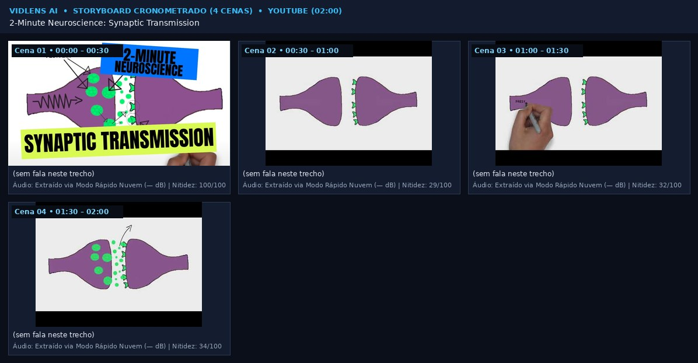
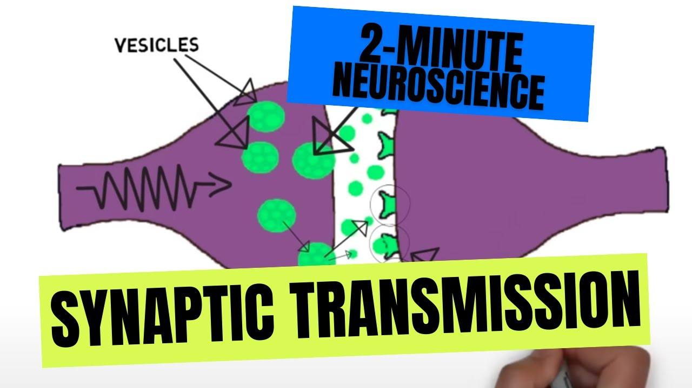
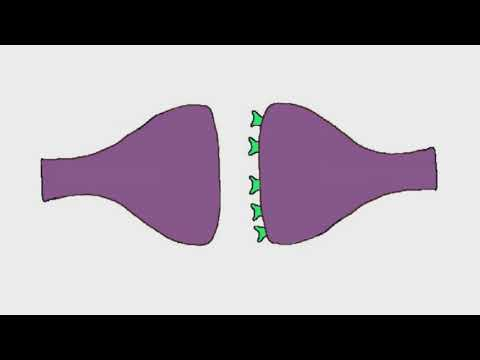
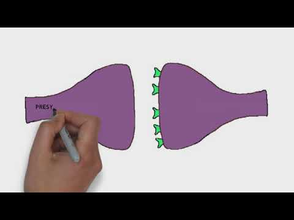
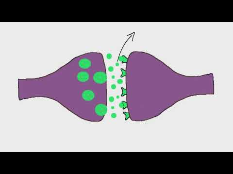

# [Pacote de Vídeo p/ IA] 2-Minute Neuroscience: Synaptic Transmission

## 1. Ficha Técnica e Fonte Original
- **Fonte Original:** https://www.youtube.com/watch?v=WhowH0kb7n0
- **Plataforma:** YOUTUBE | **Autor/Canal:** Neuroscientifically Challenged
- **Duração:** 02:00 (120.0s) | **Resolução Capturada:** 1280x720 (30.0 fps)
- **Fonte da Transcrição:** Sem fala detectada / Apenas áudio instrumental ou ambiente
- **Descrição / Notas para a IA:** Extraído via Modo Instantâneo Anti-Bloqueio (Quadros Oficiais + OCR + Visão + Transcrição).

## 2. Visão Geral Visual (Storyboard Completo em 1 Imagem)

## 3. Análise e Preservação de Áudio
- Sem faixa de áudio detectada no vídeo.

## 4. Linha do Tempo Multimodal Cena por Cena (Imagem + Descrição Visual + OCR + Áudio + Fala)
### Cena 01 (00:00 – 00:30)

- **Descrição Visual (para IAs de texto):** Quadro horizontal (widescreen) com iluminação equilibrada, alta riqueza de detalhes/bordas nítidas e predominância de tons branco/claro e verde-água/ciano. Texto detectado na tela: "ESICLES SYNAPTIC TRANSMISSION".
- **Movimento / Evolução em relação à cena anterior:** Cena inicial (referência 0%)
- **Texto Visível na Tela (OCR):** ESICLES SYNAPTIC TRANSMISSION
- **Fala sincronizada no áudio:** _[Sem fala transcrita neste intervalo]_
- **Áudio no trecho:** Extraído via Modo Rápido Nuvem (— dBFS)
- **Telemetria de Imagem:** 1280x720 | Nitidez 100/100 | Brilho 65.7% | Cores #ffffff, #d7f6a2, #595776

### Cena 02 (00:30 – 01:00)

- **Descrição Visual (para IAs de texto):** Quadro horizontal (widescreen) com iluminação equilibrada, imagem suave/fundo desfocado ou minimalista e predominância de tons branco/claro.
- **Movimento / Evolução em relação à cena anterior:** Corte de cena / grande transição visual (38.7%)
- **Texto Visível na Tela (OCR):** Nenhum texto legível detectado na tela
- **Fala sincronizada no áudio:** _[Sem fala transcrita neste intervalo]_
- **Áudio no trecho:** Extraído via Modo Rápido Nuvem (— dBFS)
- **Telemetria de Imagem:** 480x360 | Nitidez 29/100 | Brilho 60.1% | Cores #ececec, #e9edea, #4c3c4d

### Cena 03 (01:00 – 01:30)

- **Descrição Visual (para IAs de texto):** Quadro horizontal (widescreen) com iluminação equilibrada, foco moderado e predominância de tons branco/claro e cinza neutro.
- **Movimento / Evolução em relação à cena anterior:** Evolução gradual no local (variação 3.8%)
- **Texto Visível na Tela (OCR):** Nenhum texto legível detectado na tela
- **Fala sincronizada no áudio:** _[Sem fala transcrita neste intervalo]_
- **Áudio no trecho:** Extraído via Modo Rápido Nuvem (— dBFS)
- **Telemetria de Imagem:** 480x360 | Nitidez 32/100 | Brilho 56.4% | Cores #ececec, #dbdedc, #422e3b

### Cena 04 (01:30 – 02:00)

- **Descrição Visual (para IAs de texto):** Quadro horizontal (widescreen) com iluminação equilibrada, foco moderado e predominância de tons branco/claro.
- **Movimento / Evolução em relação à cena anterior:** Evolução gradual no local (variação 5.4%)
- **Texto Visível na Tela (OCR):** Nenhum texto legível detectado na tela
- **Fala sincronizada no áudio:** _[Sem fala transcrita neste intervalo]_
- **Áudio no trecho:** Extraído via Modo Rápido Nuvem (— dBFS)
- **Telemetria de Imagem:** 480x360 | Nitidez 34/100 | Brilho 59.8% | Cores #ececec, #e1efe5, #493f4d

## 5. Transcrição Completa Cronometrada
_Nenhuma fala detectada neste vídeo._