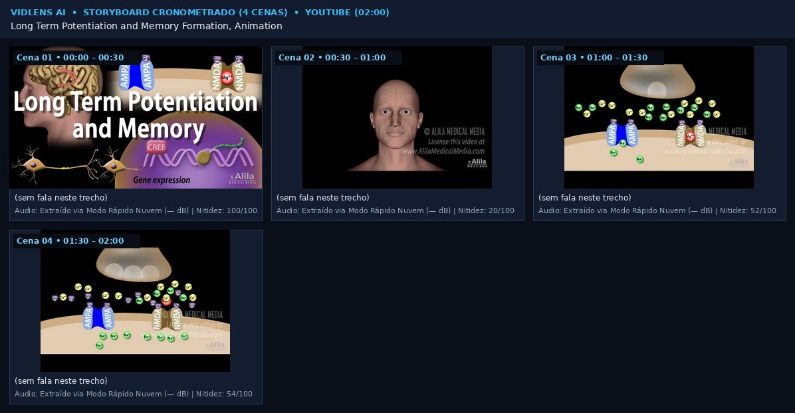
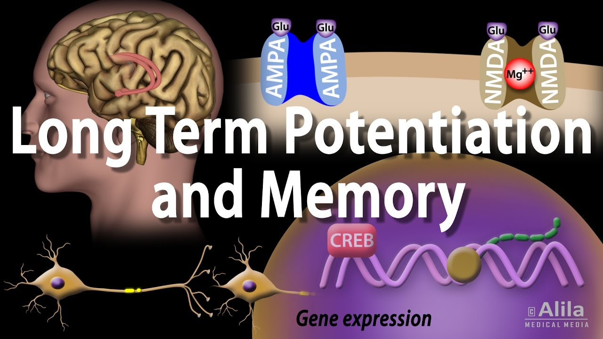
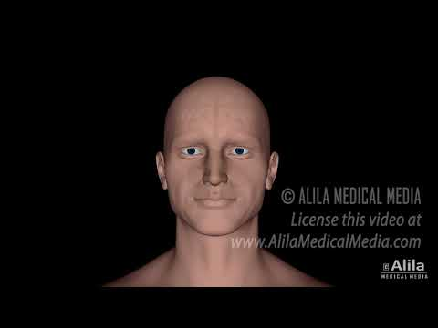
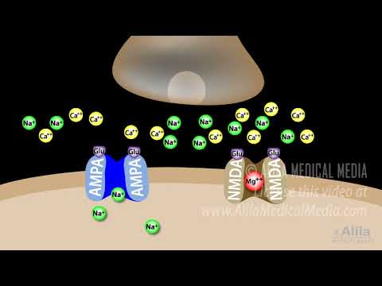
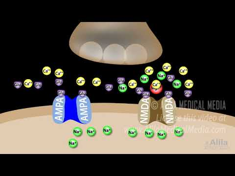

# [Pacote de Vídeo p/ IA] Long Term Potentiation and Memory Formation, Animation

## 1. Ficha Técnica e Fonte Original
- **Fonte Original:** https://www.youtube.com/watch?v=4Hm08ksPtMo
- **Plataforma:** YOUTUBE | **Autor/Canal:** Alila Medical Media
- **Duração:** 02:00 (120.0s) | **Resolução Capturada:** 1280x720 (30.0 fps)
- **Fonte da Transcrição:** Sem fala detectada / Apenas áudio instrumental ou ambiente
- **Descrição / Notas para a IA:** Extraído via Modo Instantâneo Anti-Bloqueio (Quadros Oficiais + OCR + Visão + Transcrição).

## 2. Visão Geral Visual (Storyboard Completo em 1 Imagem)

## 3. Análise e Preservação de Áudio
- Sem faixa de áudio detectada no vídeo.

## 4. Linha do Tempo Multimodal Cena por Cena (Imagem + Descrição Visual + OCR + Áudio + Fala)
### Cena 01 (00:00 – 00:30)

- **Descrição Visual (para IAs de texto):** Quadro horizontal (widescreen) com iluminação equilibrada, alta riqueza de detalhes/bordas nítidas e predominância de tons laranja/quente.
- **Movimento / Evolução em relação à cena anterior:** Cena inicial (referência 0%)
- **Texto Visível na Tela (OCR):** Nenhum texto legível detectado na tela
- **Fala sincronizada no áudio:** _[Sem fala transcrita neste intervalo]_
- **Áudio no trecho:** Extraído via Modo Rápido Nuvem (— dBFS)
- **Telemetria de Imagem:** 1280x720 | Nitidez 100/100 | Brilho 35.5% | Cores #d0c1b5, #89636f, #211424

### Cena 02 (00:30 – 01:00)

- **Descrição Visual (para IAs de texto):** Quadro horizontal (widescreen) com ambiente escuro/noturno, imagem suave/fundo desfocado ou minimalista e predominância de tons vermelho/vinho e preto/escuro.
- **Movimento / Evolução em relação à cena anterior:** Corte de cena / grande transição visual (32.6%)
- **Texto Visível na Tela (OCR):** Nenhum texto legível detectado na tela
- **Fala sincronizada no áudio:** _[Sem fala transcrita neste intervalo]_
- **Áudio no trecho:** Extraído via Modo Rápido Nuvem (— dBFS)
- **Telemetria de Imagem:** 480x360 | Nitidez 20/100 | Brilho 7.8% | Cores #624a44, #030001, #000000

### Cena 03 (01:00 – 01:30)

- **Descrição Visual (para IAs de texto):** Quadro horizontal (widescreen) com iluminação equilibrada, foco moderado e predominância de tons laranja/quente e preto/escuro.
- **Movimento / Evolução em relação à cena anterior:** Variação visual de 24.6% • Deslocamento aparente: esquerda → direita / baixo → cima
- **Texto Visível na Tela (OCR):** Nenhum texto legível detectado na tela
- **Fala sincronizada no áudio:** _[Sem fala transcrita neste intervalo]_
- **Áudio no trecho:** Extraído via Modo Rápido Nuvem (— dBFS)
- **Telemetria de Imagem:** 480x360 | Nitidez 52/100 | Brilho 28.5% | Cores #a19682, #01000f, #000000

### Cena 04 (01:30 – 02:00)

- **Descrição Visual (para IAs de texto):** Quadro horizontal (widescreen) com iluminação equilibrada, foco moderado e predominância de tons laranja/quente e preto/escuro.
- **Movimento / Evolução em relação à cena anterior:** Quase estático (variação 1.7%)
- **Texto Visível na Tela (OCR):** Nenhum texto legível detectado na tela
- **Fala sincronizada no áudio:** _[Sem fala transcrita neste intervalo]_
- **Áudio no trecho:** Extraído via Modo Rápido Nuvem (— dBFS)
- **Telemetria de Imagem:** 480x360 | Nitidez 54/100 | Brilho 28.5% | Cores #a09682, #010011, #000000

## 5. Transcrição Completa Cronometrada
_Nenhuma fala detectada neste vídeo._